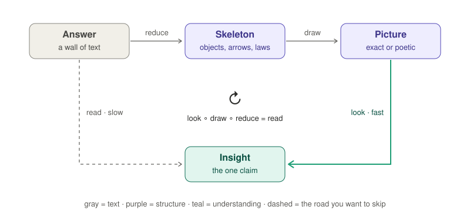
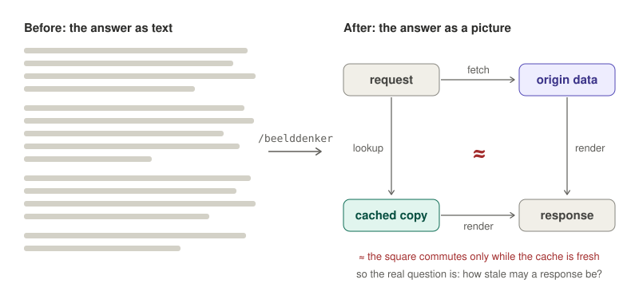
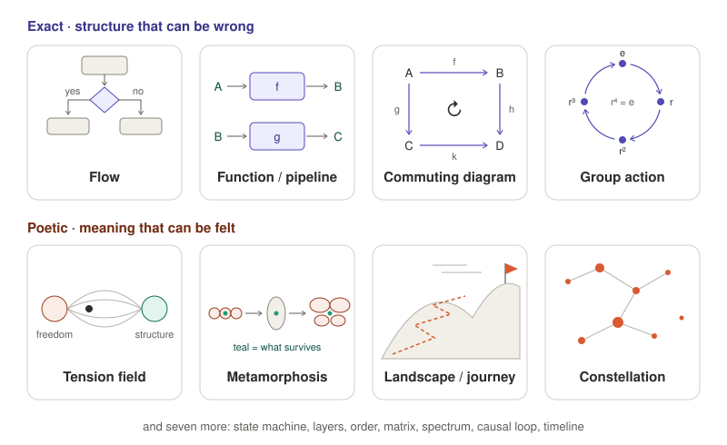
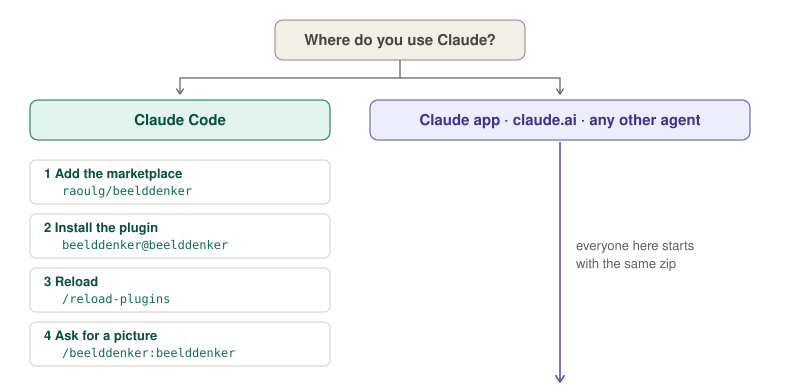
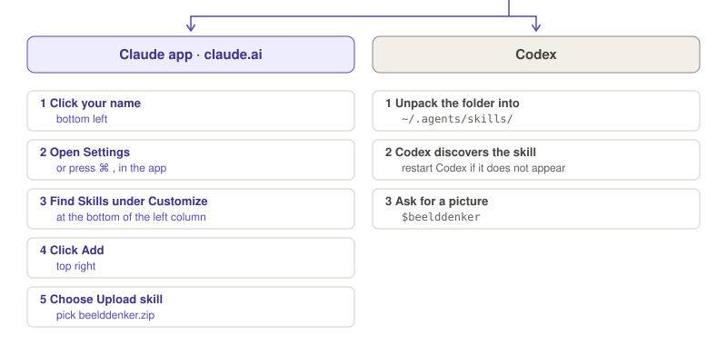

# beelddenker

*Beelddenker* is Dutch for **visual thinker**: someone who takes in a picture faster than a
page of text. This is a skill for Claude and Codex that turns a long answer into a picture:
a flow, a commuting diagram, a group action, or a visual metaphor, whichever fits the thought.

<p align="center">
  
</p>

The skill works when the diagram commutes: looking at the picture has to give you the same
insight as reading the whole answer, only faster.

## An example

You ask whether to cache an API call and get four paragraphs back. Type `/beelddenker` and you
get this:

<p align="center">
  
</p>

The picture shows more than the text did. The two routes give the same response only *up to*
staleness, so the question you actually have to answer is how stale a response may be.

## How it decides what to draw

1. **Skeleton.** The agent reduces the answer to its objects, its arrows (what goes in, what comes
   out), its order, its laws (what is equal, what stays invariant, what pulls against what),
   and the one claim the picture has to make obvious.
2. **Register.** If the content has structure that can be wrong, the picture is *exact*. If it
   is about meaning, judgement or a line of thought, the picture is *poetic*. Sometimes you get
   both: the exact schema first, then a small metaphor for the why.
3. **Principle.** It picks one of fifteen visual principles that matches the shape of the
   skeleton:

<p align="center">
  
</p>

4. **Colour.** One colour means one thing per picture, and a legend says what.
5. **Medium.** It uses the best medium available: inline visuals where supported, an
   artifact, Mermaid or JSON Canvas for Obsidian, tikz-cd for LaTeX, and Unicode diagrams in a
   plain terminal.

A metaphor has to preserve structure, the way a functor does: each relation in the image must
mirror a relation in the idea. Otherwise it is only decoration. The full method is in
[SKILL.md](skills/beelddenker/SKILL.md), and the catalogue of principles is in
[principles.md](skills/beelddenker/references/principles.md).

## Install

<p align="center">
  <br>
  <a href="https://github.com/raoulg/beelddenker/releases/latest/download/beelddenker.zip"></a><br>
  
</p>

### Claude app and claude.ai

1. Download **[beelddenker.zip](https://github.com/raoulg/beelddenker/releases/latest/download/beelddenker.zip)**.
   Do not unpack it.
2. Click your name at the bottom left.
3. Open **Settings** (or press <kbd>⌘</kbd> <kbd>,</kbd> in the app).
4. Under **Customize**, open **Skills**.
5. Click **Add** at the top right and choose **Upload skill**. Pick `beelddenker.zip`.

If you cannot find Skills, turn on code execution under **Settings › Capabilities** first. On
Team and Enterprise plans, an owner has to allow skills for the organization.

### Claude Code

Run these two commands inside Claude Code:

```text
/plugin marketplace add raoulg/beelddenker
```

```text
/plugin install beelddenker@beelddenker
```

Then run `/reload-plugins` or start a new session. The skill is called
`/beelddenker:beelddenker`, and Claude also picks it up when you say "make it visual".

You can also install it from your shell:

```bash
claude plugin marketplace add raoulg/beelddenker && claude plugin install beelddenker@beelddenker
```

### Codex

Download [beelddenker.zip](https://github.com/raoulg/beelddenker/releases/latest/download/beelddenker.zip).
From the directory containing the download, unpack it into
[Codex's personal skills directory](https://learn.chatgpt.com/docs/build-skills):

```bash
mkdir -p ~/.agents/skills
unzip beelddenker.zip -d ~/.agents/skills
```

The result is `~/.agents/skills/beelddenker/SKILL.md`. Codex discovers the skill automatically;
if it does not appear, restart Codex. You can also ask Codex to install it from
`https://github.com/raoulg/beelddenker/tree/main/skills/beelddenker` with `$skill-installer`.

### Other agents that read skills

Unpack the same zip into that agent's skills directory. For Claude Code without the plugin
system, use `~/.claude/skills/`. The zip contains a `beelddenker/` folder with `SKILL.md`.

## Use

- Right after a long answer, type `/beelddenker` in the Claude app or `$beelddenker` in Codex.
- Ask in your own words: "make it visual", "draw it", "I lost the overview", "give me a
  metaphor". Dutch works too: "maak het visueel", "teken het".
- Give it a topic to get a visual answer from the start: `$beelddenker how does TCP work`
  in Codex, or `/beelddenker how does TCP work` in the Claude app.

It answers in the language you write in.

## License

MIT
